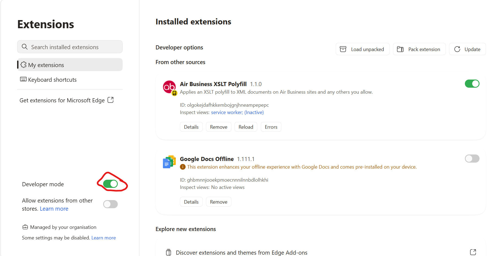
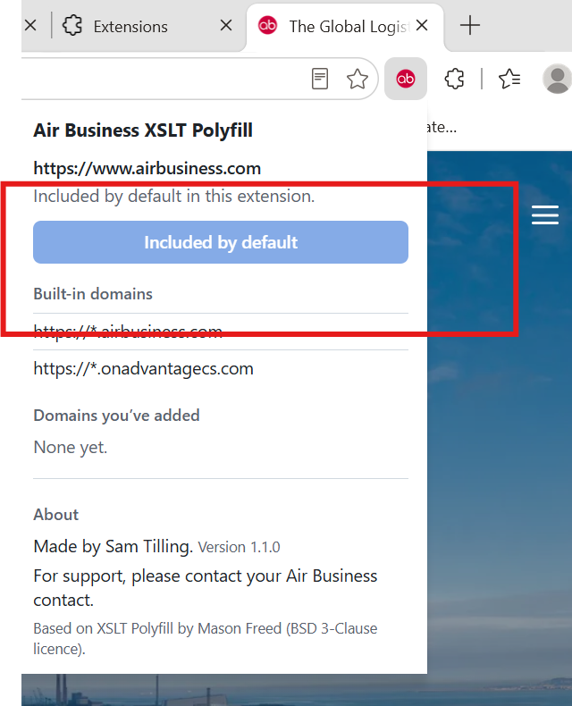

# Air Business XSLT Polyfill

Some Air Business systems display pages built from XML. Newer versions of Microsoft Edge and Google Chrome no longer display these pages properly; you may see raw code or a blank page instead.

This extension fixes that. Once installed, those pages display as normal.

Air Business sites work straight away. If you need it on another site, you can add that site yourself at any time by clicking the extension's red **ab** button in your browser toolbar (see [Adding another site](#adding-another-site)).

It works in **Microsoft Edge** and **Google Chrome** on Windows and Mac.

---

## Before you start

You'll need the extension folder, usually supplied as a zip file by your Air Business contact.

1. Save the zip file somewhere permanent, such as your **Documents** folder.
2. Right-click the zip file and choose **Extract All…**, then **Extract**.
3. Leave the extracted folder where it is. **Don't move, rename or delete it later**; the browser loads the extension from that folder every time it starts.

> **If your Documents folder is in OneDrive:** right-click the extracted folder and choose **Always keep on this device**. Otherwise the extension may stop working when OneDrive frees up space.

---

## Installing

### Microsoft Edge

1. Open Edge and type `edge://extensions` into the address bar, then press **Enter**.
2. Turn on **Developer mode** (switch near the bottom of the left-hand panel; on a narrow window, open the menu at the top left first).
3. Click **Load unpacked** (top right, under **Installed extensions**).
4. Select the extracted folder (the one containing `manifest.json`) and click **Select Folder**.
5. **Air Business XSLT Polyfill** now appears in your list of extensions.

*The Edge extensions page after installing: **Developer mode** is circled in red, **Load unpacked** is at the top right, and **Air Business XSLT Polyfill** is listed and switched on.*

### Google Chrome

1. Open Chrome and type `chrome://extensions` into the address bar, then press **Enter**.
2. Turn on **Developer mode** (switch at the top right).
3. Click **Load unpacked**.
4. Select the extracted folder (the one containing `manifest.json`) and click **Select Folder**.
5. **Air Business XSLT Polyfill** now appears in your list of extensions.

### Pin it to your toolbar

1. Click the **Extensions** button (the jigsaw-piece icon) next to the address bar.
2. Click the pin (Chrome) or eye (Edge) icon next to **Air Business XSLT Polyfill**.

The extension's red **ab** button now sits in your toolbar, next to the address bar. Click it whenever you want to check which sites it's working on or add a new one. To open this guide at any time, click the **Help** button at the top of the pop-up.

> **Can't see Developer mode or Load unpacked?** Your computer's settings may block it. Please contact your Air Business contact.

---

## Using it

### Air Business sites work automatically

There's nothing to do for these sites:

- `airbusiness.com` and all its sub-sites
- `onadvantagecs.com` and all its sub-sites

If you click the red **ab** button while on one of these sites, it shows **Included by default**:

### Adding another site

You can add any other site yourself, straight from the extension button in your toolbar. If a page isn't displaying properly on a site that isn't listed above:

1. Go to that page.
2. Click the red **ab** button in your browser toolbar, next to the address bar. (If you can't see it, click the jigsaw-piece **Extensions** button first.)
3. Click **Add this domain**.
4. Your browser asks for permission. Click **Allow**.

The page reloads and should now display correctly. The extension remembers the site from then on.

### Removing a site

Click the red **ab** button in your toolbar, then either:

- click **Remove this domain** while you're on that site, or
- click **Remove** next to the site under **Domains you've added**.

Air Business sites are built in and can't be removed.

---

## Your privacy

- The extension only works on Air Business sites and any sites you choose to add.
- It only changes pages that are XML documents; normal web pages are left alone.
- It doesn't collect, store or send any of your information anywhere. Everything happens inside your browser.

---

## Troubleshooting

| Problem | What to try |
| --- | --- |
| A page still shows raw code or a blank page | Click the extension's icon and check the site is listed. If not, click **Add this domain**. Then refresh the page. |
| The extension has disappeared | Check you haven't moved or deleted the extracted folder. If you have, put it back or install again using the steps above. |
| Chrome shows a warning about developer mode extensions | This is normal for extensions installed this way. Choose to keep the extension enabled. |
| The browser says the extension is corrupted or can't load | Delete the extension from the extensions page, extract a fresh copy of the zip file and install again. |

---

## Releases

You can check which version you have by clicking the red **ab** button in your toolbar; it's shown under **About**.

New versions are supplied by your Air Business contact as a zip file named like `air-business-xslt-polyfill-1.1.0.zip`, where the numbers are the version.

### Updating to a new version

1. Extract the new zip file and replace the contents of your existing extension folder with it. Keep the folder in the same place.
2. Go to `edge://extensions` or `chrome://extensions`.
3. Click **Reload** (the circular arrow) on **Air Business XSLT Polyfill**.
4. Click the red **ab** button and check the version under **About** matches the new one.

Sites you've added are kept when you update.

### Version history

| Version | What's new |
| --- | --- |
| 1.1.0 | First Air Business release. Works automatically on Air Business sites; **Add this domain** button for other sites; **Help** button; Air Business icon. |

---

## Support

You can reopen this guide at any time from the **Help** button in the extension's pop-up.

For anything else, please contact your Air Business contact.

---

## Credits

Made by Sam Tilling.

Based on the open-source [XSLT Polyfill](https://github.com/mfreed7/xslt_polyfill) by Mason Freed, used under the BSD 3-Clause licence (see `LICENSE`).
